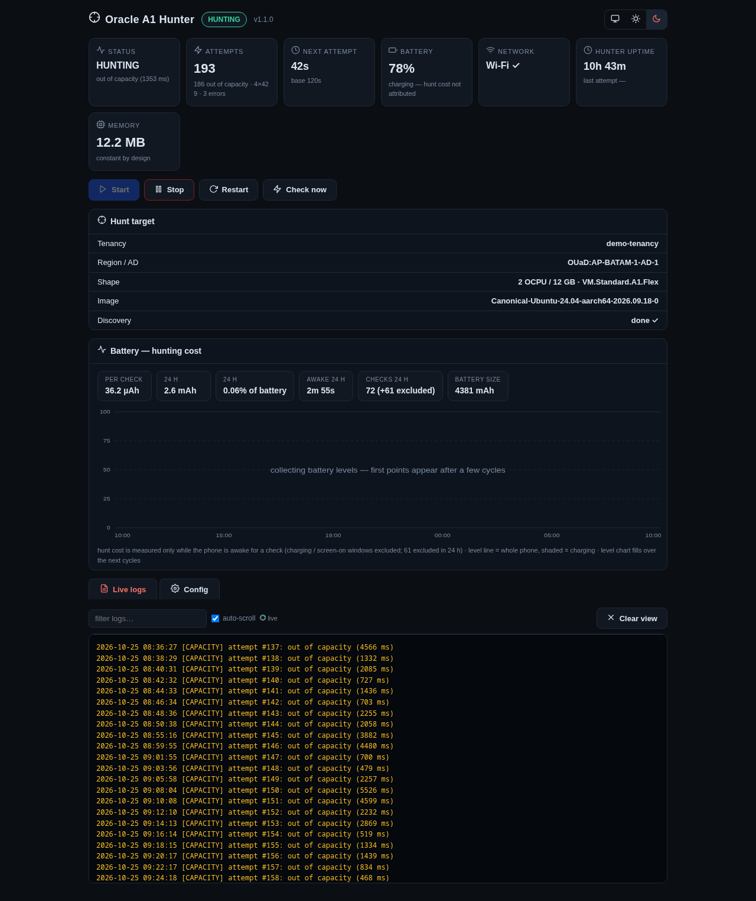
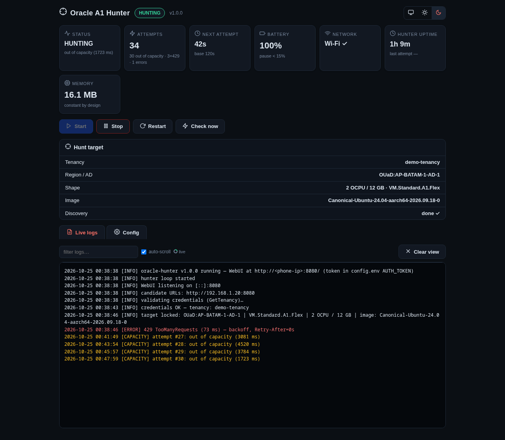
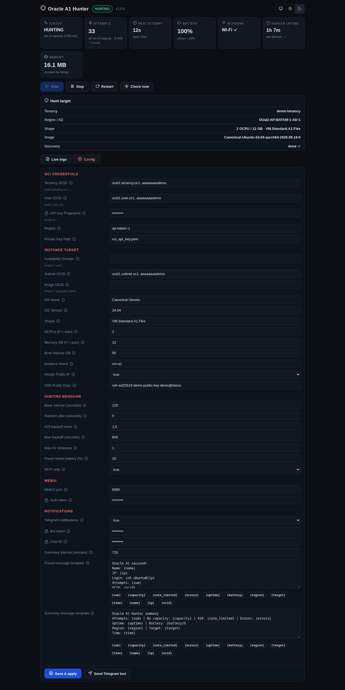

# Oracle A1 Hunter

A battery-friendly Always Free **Oracle Cloud A1 instance hunter** for rooted Android phones, with a built-in WebUI for monitoring and control.

It repeatedly calls the OCI `LaunchInstance` API for `VM.Standard.A1.Flex`. When capacity is unavailable Oracle answers `500 OutOfHostCapacity` and the hunter simply tries again; the moment capacity appears, the instance is created on the spot — with a loud notification and (optionally) a Telegram message telling you it's yours.

Written as a **single static Go binary (~8 MB, ~14 MB RAM)** that runs as a root service via KernelSU/Magisk `service.d`. No Termux, no wake locks held overnight, no server required — just a phone that would otherwise sit in a drawer.

> All screenshots below were taken from a **real hunt in progress** on a Redmi Note 8 Pro running AxionOS (Android 16) + KernelSU Next — same binary this repo builds. Personal identifiers (tenancy name, OCIDs, LAN IP, SSH key) were replaced with demo values before capture; everything else is untouched. The amber lines are the healthy `500 OutOfHostCapacity` answers Oracle gives while capacity is scarce.

## Screenshots

| Dashboard | Live logs |
|---|---|
|  |  |

**Config editor** — every field has an ⓘ tooltip, bools are dropdowns, Telegram templates get click-to-insert placeholder chips and a **Send test** button:



## Why this exists

Existing hunters (including the one this project replaced) are Termux scripts that hold `termux-wake-lock` to keep retrying. That keeps the CPU awake all night: **~50% battery drain per night** just to poll an API. This project was measured against that baseline and designed around Android's real power management:

- **Deep sleep between checks.** Scheduling uses a relative `CLOCK_BOOTTIME` timerfd plus the RTC wakealarm (`/sys/class/rtc/rtc0/wakealarm`) — the same wake path Android's AlarmManager uses. The phone sleeps; it is woken for ~1–3 seconds per check, then sleeps again.
- **No persistent wake locks.** Verified via `wakeup_sources`.
- **Guards.** Pause below a battery threshold (default 15%), Wi-Fi-only mode, automatic backoff on `429 TooManyRequests`.

## Features

- Launch loop with configurable interval (default 120 s — proven safe; 90 s or below tends to trip 429 rate limiting) and optional jitter
- Automatic discovery of availability domain, image (by OS name/version) and the largest allowed A1 allocation (`OCPUS=0`)
- Hidden-throttle detection: the launch endpoint sometimes answers `401 NotAuthenticated` while identity calls still return `200` — the hunter verifies against the identity API and backs off instead of giving up
- **WebUI** (default `:8080`, token-authenticated):
  - dashboard: status, attempt counters, next-attempt countdown, battery, network, uptime
  - start / stop / restart / check-now controls
  - live log stream (SSE) with per-level coloring — amber for `out of capacity`, red for errors/429, green for success
  - full configuration editor: bool fields as dropdowns, every field has an ⓘ tooltip, secrets masked
  - theme switcher (system / light / dark), inline SVG icons, zero external dependencies
- **Telegram notifications** with editable templates (`{sum}`, `{capacity}`, `{ip}`, `{ocid}`, … — click-to-insert chips in the UI) and optional periodic summaries with a **Send test** button
- Rotating log file, boot autostart, one-shot `-once` / `-validate` CLI modes

## Try it (no Go toolchain needed)

Grab a prebuilt binary from [**Releases**](../../releases) — `hunter-android-arm64` for phones, `hunter-linux-arm64`/`hunter-linux-amd64` for servers or SBCs — then follow the [Install](#install-rooted-android-kernelsu-or-magisk) steps below, skipping the build. A ready-made boot script lives at [`scripts/99-oracle-hunter.sh`](scripts/99-oracle-hunter.sh) and an annotated config template at [`config.env.example`](config.env.example). Version history: [`CHANGELOG.md`](CHANGELOG.md).

## Install (rooted Android, KernelSU or Magisk)

Requirements: a rooted phone with `service.d` support (KernelSU, KernelSU Next, Magisk), an Oracle Cloud account (Always Free), and an ADB-connected computer to deploy.

```bash
# 1. Build
GOOS=android GOARCH=arm64 CGO_ENABLED=0 go build -trimpath -ldflags="-s -w" -o hunter .

# 2. Generate an API key pair and compute the fingerprint (MD5!)
openssl genrsa -out oci_api_key.pem 2048
openssl rsa -in oci_api_key.pem -pubout -out oci_api_key_public.pem
openssl rsa -in oci_api_key.pem -pubout -outform DER | openssl md5

# 3. Register the public key: Oracle Console → Profile → My profile →
#    API keys → Add API key → Paste public key. The dialog shows the fingerprint.

# 4. Deploy (push to /sdcard first — /data/adb is not adb-writable)
adb push hunter /sdcard/hunter
adb push oci_api_key.pem /sdcard/oci_api_key.pem
adb shell su -c 'mkdir -p /data/adb/oracle-hunter/bin /data/adb/oracle-hunter/logs'
adb shell su -c 'cp /sdcard/hunter /data/adb/oracle-hunter/bin/ && chmod 755 /data/adb/oracle-hunter/bin/hunter'
adb shell su -c 'cp /sdcard/oci_api_key.pem /data/adb/oracle-hunter/ && chmod 600 /data/adb/oracle-hunter/oci_api_key.pem'

# 5. First run creates config.env with sane defaults; fill in credentials
#    via the WebUI (recommended), or start from config.env.example.
adb shell su -c '/data/adb/oracle-hunter/bin/hunter -validate -config /data/adb/oracle-hunter'

# 6. Boot autostart — push scripts/99-oracle-hunter.sh from this repo:
adb push scripts/99-oracle-hunter.sh /sdcard/99-oracle-hunter.sh
adb shell su -c 'cp /sdcard/99-oracle-hunter.sh /data/adb/service.d/ && chmod 755 /data/adb/service.d/99-oracle-hunter.sh'
```

Open the WebUI from the phone (`http://localhost:8080`) or from a computer on the same network (`http://<phone-ip>:8080`). First-time login accepts the token via URL: `http://<phone-ip>:8080/#token=<AUTH_TOKEN from config.env>`; it is then remembered by the browser.

## Configuration

Everything lives in `config.env` (also editable from the WebUI). Highlights:

| Key | Default | Meaning |
|---|---|---|
| `INTERVAL_BASE_SECS` | 120 | Delay between attempts. 90 or less triggers 429. |
| `OCPUS` / `MEMORY_GB` | 0 / 0 | 0 = auto: largest allocation your tenancy allows. |
| `MAX_INSTANCES` | 1 | Stop hunting once this many A1 instances exist. |
| `BATTERY_MIN_PCT` | 15 | Pause below this battery level. |
| `WIFI_ONLY` | true | Only hunt on Wi-Fi. |
| `TELEGRAM_ENABLED` | false | Bot notifications with editable templates. |
| `TELEGRAM_SUMMARY_INTERVAL_MINS` | 0 | Periodic status message (0 = off, min 15). |

## Troubleshooting / gotchas learned the hard way

- **API key fingerprint is the MD5** of the DER public key (`openssl rsa -pubout -outform DER | openssl md5`), *not* SHA-256. A SHA-256 fingerprint yields endless 401s even though the key is registered correctly.
- **POST bodies must be signed SDK-style.** The launch endpoint rejects body-bearing requests unless `x-content-sha256` (body hash) is included in the signing string, along with SDK-like `opc-request-id`/`opc-client-info`/`user-agent` headers. Symptom: GETs succeed while `CreateInstance` gets 401/429 with misleading messages.
- **`401 NotAuthenticated` on launch while identity returns 200** is a hidden rate limit, not an auth problem. Back off; don't re-register keys.
- **Build with `GOOS=android`** (not `linux`), or TLS fails with "certificate signed by unknown authority" — Android CA certs live in `/system/etc/security/cacerts`.
- **Native processes have no DNS resolver config** on Android; the binary ships its own resolver (8.8.8.8/1.1.1.1).
- **`CLOCK_BOOTTIME_ALARM` quirks**: on some kernels its timeline excludes suspend time, so absolute timers drift; use relative timers and the RTC wakealarm instead.
- **AP/client isolation** on some routers blocks computer→phone HTTP; use `adb forward tcp:18080 tcp:8080` over USB instead.
- Complex `adb shell su -c '...'` commands with nested quotes silently drop to the unprivileged shell — always push a script file and run `su -c sh /sdcard/script.sh`.

## Limitations

- Requires root (`service.d`). A Termux build would work but loses the suspend-friendly scheduling that makes this battery-efficient.
- One region/tenancy per install (run multiple copies with separate config dirs if needed).

## License

MIT — do whatever you want, attribution appreciated. No warranty: you are hitting Oracle's API with your own account.
